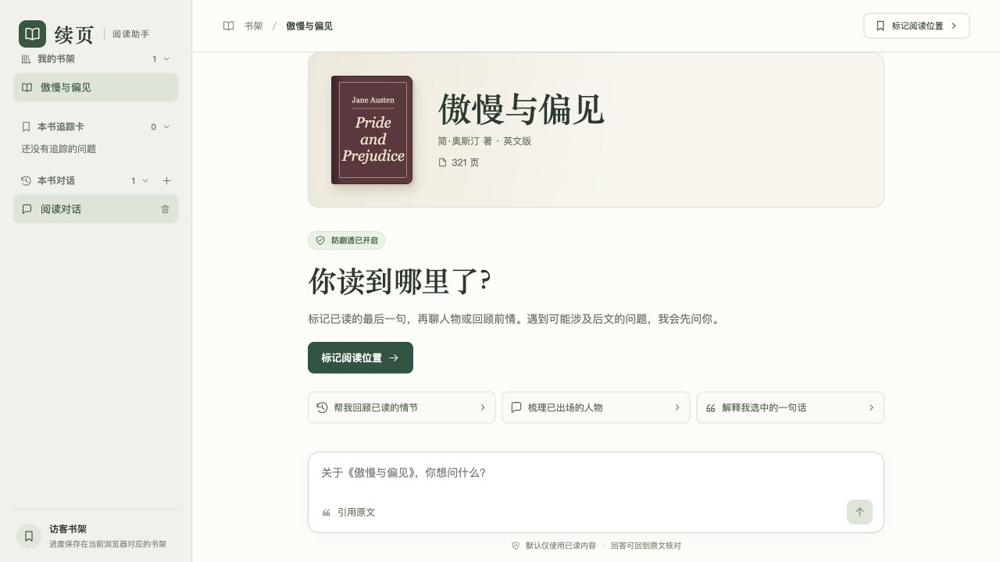
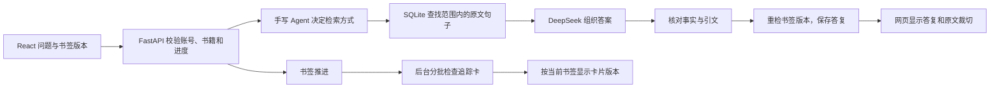

# 续页 · 防剧透阅读助手

续页按读者标记的句子限制 Agent 可以使用的原文。同一本书、同一个问题，推进书签后能回答新读到的情节。点击引用可以核对原句，回退时会收起超前的回答和追踪卡更新。

**[观看 87 秒实机演示](demo.mp4)** · [按页复现演示](docs/求职演示.md) · [验收结果与故障复盘](docs/验收.md)

[](demo.mp4)

展示围绕《傲慢与偏见》的一条连续线索展开。威克姆先向伊丽莎白讲自己的版本，达西随后在信里回应。沿着同一个问题推进和回退书签，可以看到答案、引文和追踪卡如何随读者掌握的信息变化。

| 在演示里可以看到 | 可查看的实现 |
|---|---|
| 来信前问同一件事，Agent 提示已读证据不足。推进书签后，它能引用来信回答。 | [Agent 的检索、生成与核验](backend/agent.py) |
| 点击引用打开对应的 PDF 原句。把书签退回去，较晚的引文也会收起。 | [阅读边界与引文接口](backend/app.py) |
| 把问题加入追踪，新读到的证据会更新卡片，并保留此前版本。 | [追踪任务和版本更新](backend/tracking.py) |

前端使用 React 和 TypeScript，后端使用 FastAPI 和 SQLite。DeepSeek 通过后端网关调用。下载视频或浏览仓库即可查看展示，运行模型问答需要自己的网关密钥。

## 一次提问的数据流



服务端按书签限制关键词与相邻句检索，保存回答前再次校验书签版本。原文编号和 PDF 坐标支持精确引文。对于跨章问答，按所问环节分别取证，并核对组织后的结论。遇到候选结论未通过审校时，显示仍可核对的事实或原文。

## 启动

在本目录安装 Python 3.12、Node.js 22 和 pnpm，然后运行以下命令。

```sh
python3 -m venv .venv
.venv/bin/python -m pip install -r requirements.txt
pnpm --dir frontend install --frozen-lockfile
pnpm --dir frontend run build
cp -n .env.example .env
.venv/bin/python -m uvicorn backend.app:app --host 127.0.0.1 --port 8767
```

打开 [本地网页](http://127.0.0.1:8767)。网页里的书架、阅读与句级书签可直接操作。发送问答或运行追踪前，在项目根目录的 `.env` 填入 `RELAYCORE_API_KEY`，然后重启后端。默认网关为 `https://relaycore.cn/v1`，模型为 `deepseek-v4.1-flash-1017`。如果密钥分组提供其他模型或 Base URL，可用 `RELAYCORE_MODEL` 和 `RELAYCORE_BASE_URL` 分别指定，以该密钥可查到的模型 ID 和控制台给出的 `/v1` 地址为准。部署时可在后端环境中设置同样的变量并重新创建容器。

问答、证据核验和追踪卡统一通过 RelayCore 请求模型。`RELAYCORE_BASE_URL` 只接受 `relaycore.cn` 或其子域名的 HTTPS `/v1` 地址。缺少密钥或网关出错时，续页会给出对应提示。数据保存在 `data/reader-v1`，包含书籍、进度与问答。备份这个目录时先停止本地服务。

RelayCore 默认关闭推理模式，可用 `RELAYCORE_REASONING_EFFORT=high` 启用。启用前可先核对该分组的模型支持情况。

## 试读

求职展示使用内置的 [《傲慢与偏见》英文 PDF](samples/傲慢与偏见（英文版）.pdf)。普通本机启动后可以直接导入这份 PDF，或按[演示流程](docs/求职演示.md)启动独立的样书模式。选择「调整进度」标记书中任意一句，点回答里的「查看原文依据」核对原句。一次性剧透许可只适用于当前问题，书签仍由读者自己推进或回退。回答期间可以停止，失败后可以保留问题重试。

在回答下点「持续追踪」，或展开左栏「本书追踪卡」点卡名。对同一本书用不同说法追踪同一问题，会打开已有卡片。旧版普通回答下的「换个说法」只使用提问时的证据。左栏三组可分别折叠，各行右侧有删除按钮。删对话保留已追踪的卡片，删卡保留原对话。推进书签后，后台检查新增原文，展示变化和可点击的引文。回退时恢复较早版本。没有新证据时只更新检查位置。

「更新记录」先按章节显示新增线索或判断订正。没有目录的 PDF 按页归组。可按 PDF 页码筛选并定位到对应原句，返回追踪卡后继续看同一条更新。

## 验证

```sh
.venv/bin/python -m unittest discover -s tests -p 'test_*.py'
PYTHONPATH=. .venv/bin/python tests/live_reading.py
PYTHONPATH=. .venv/bin/python tests/evaluate_reading.py
```

后两项通过配置好的 RelayCore 接口调用模型。第二项验证上传、已读回答、单题授权、追踪更新和回退。第三项在临时数据库运行示范书评测，亦可在命令末尾给出题号来单独复测。

示范书评测可加 `--json-out /tmp/xudu-result.json` 导出逐题结果。退出码 `0` 表示所选案例全部通过，`1` 表示内容检查失败，`2` 表示参数无效或本轮出现模型、运行异常。GitHub Actions 安排离线回归、前端构建和静态资源检查。

要复测跨章问答和跨话题回指，下载 [Bookstacks 321 页英文版《傲慢与偏见》](https://bookstacks.org/downloads/austen/austen_pride-and-prejudice_eng/austen_pride-and-prejudice_eng.pdf)，运行 `PYTHONPATH=. .venv/bin/python tests/live_novel.py /path/to/pride-and-prejudice.pdf --trace`。脚本校验版本，在独立书架通过 RelayCore 调用 DeepSeek 模型，并逐项核对回答覆盖、引文和书签回退。加 `--through-reaction` 可以复测到第 36 章为止。

同一命令加 `--recap-only` 可复测 PDF 第 101 页和第 131 页的前情回顾。脚本检查开篇、中段和书签附近的证据，以及引用的位置是否在已读范围内。

## 账号与跨设备

使用书架底部的「登录 / 注册」。从当前访客书架创建账号时，书签、已有对话、引文和追踪卡会转入账号。换浏览器登录后可继续阅读。不同浏览器可以各自打开不同书籍，同一本书的书签会同步。遇到另一设备刚更新书签时，页面会提示刷新后的最新位置，重新选择即可主动回退。

Linux 私人试用及公开演示使用独立配置，见[部署说明](deploy/README.md)。两本样书的真实连续对话验收可运行 `PYTHONPATH=. .venv/bin/python tests/live_conversation.py`。

## 样书

《傲慢与偏见》《西游记》和《爱玛》的样书 PDF 来自 Bookstacks，保留原文件的底本及版次说明。《西游记》和《爱玛》用于既有回归测试。PDF 均保留发行方原件。两本奥斯汀作品的数字底本按 [CC BY-SA 4.0](https://creativecommons.org/licenses/by-sa/4.0/) 提供，版本信息与署名可见各 PDF 第 2 页。
